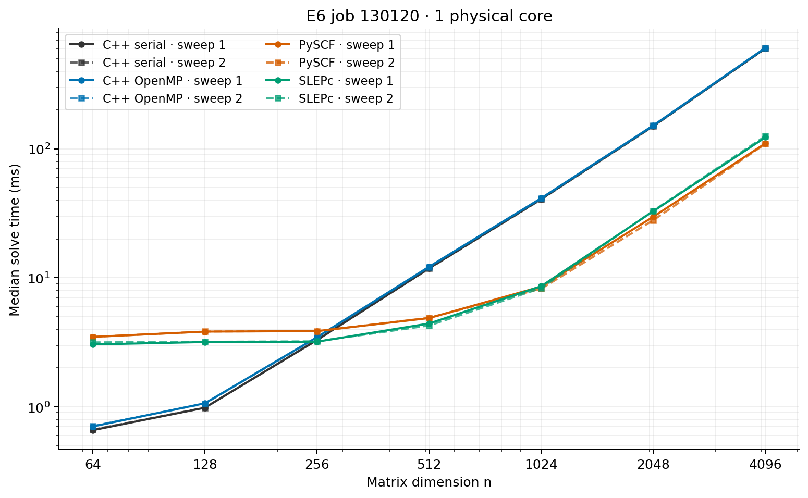
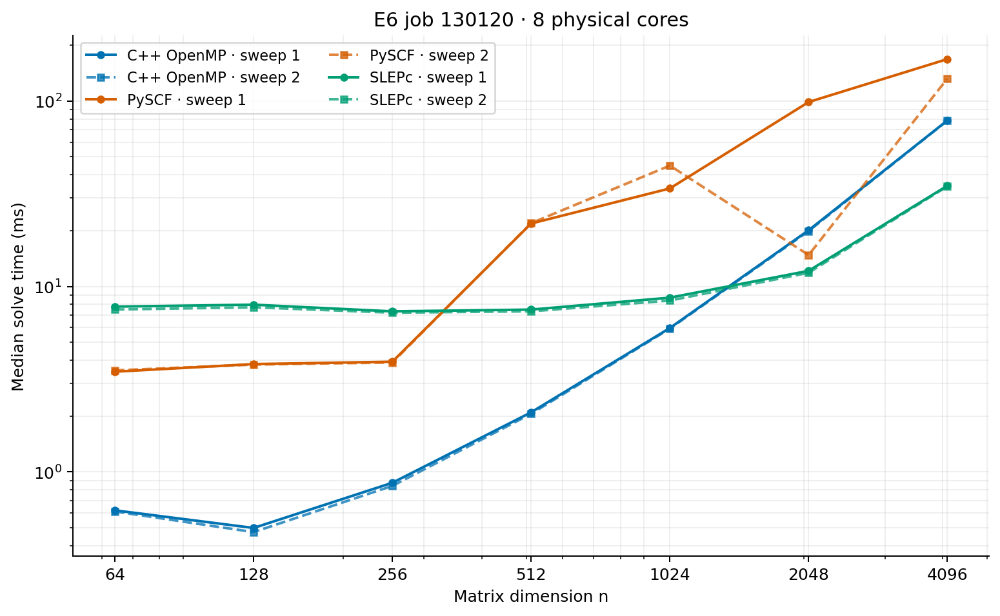
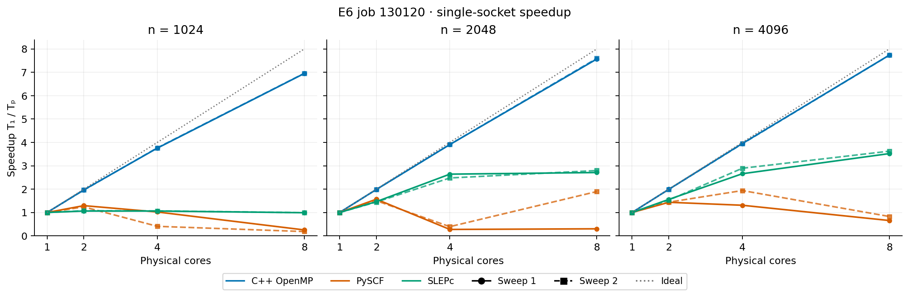
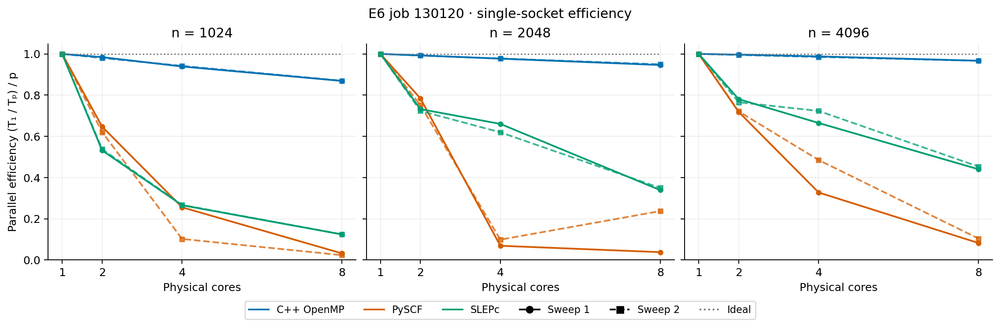
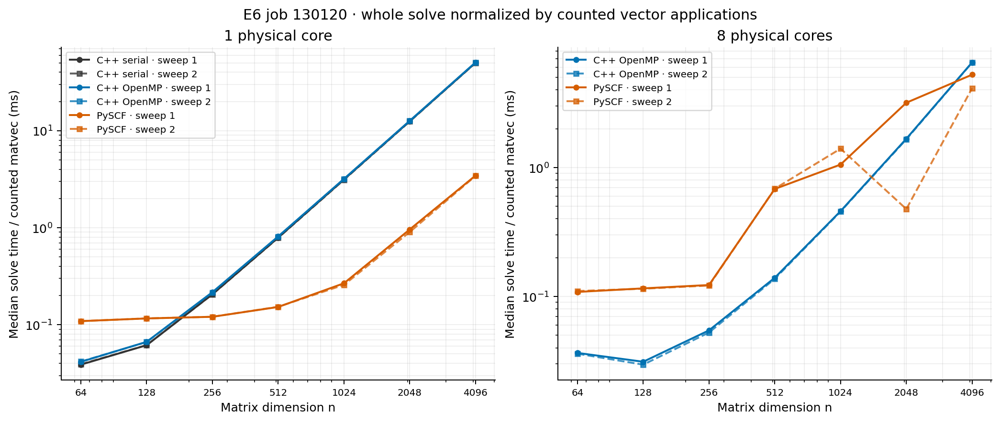

# Davidson baselines on Euler: final report

**Primary result: E6 job 130120, single-socket physical-core scaling.** The experiment compares C++ serial/OpenMP, PySCF and SLEPc over n=64–4096 with 1/2/4/8 cores. E4 job 129538 supplies the earlier cross-socket comparison. All tables and figures are generated from returned artifacts by `analysis/baseline_report.py`; no local smoke timings are included.

**Reading the numbers:** every paired cell is **sweep 1 / sweep 2**. These are medians of separate solve repetitions; samples are not pooled and a pair is not a confidence interval. FAIL/MISSING never contributes a valid timing. [Complete E6 rows, ranges, counts and evidence](details.md); [E4 row-level comparison](e4-details.md); [machine-readable audit](report-audit.json).

## Jobs and validation

| Step | Job | Configs | Measured solves | Warm-ups | Failed | Missing | Wall seconds | Evidence |
| --- | --- | --- | --- | --- | --- | --- | --- | --- |
| E6 | 130120 | 182 | 22569 | 182 | 0 | 0 | 579 | [CSV](../../results/euler/E6_130120/summary.csv) |
| E4 | 129538 | 98 | 11798 | 98 | 0 | 0 | 268 | [CSV](../../results/euler/E4_129538/summary.csv) |
| E5 | 129548 | 8 | 8 | 8 | 0 | 0 | 25 | [CSV](../../results/euler/E5_129548/summary.csv) |

E6 has 75 capped configurations below one timed second; E4 has 42. They remain in the tables with their repeat outcomes in the appendices. The audit cross-checks CSV aggregates, local/combined raw samples, strict gates, input/reference bytes, placement and rank records. E4/E6 numerical source hashes, build identity/flags, library versions, inputs/references and aligned settings agree; the placement harness and affinity settings intentionally differ.

**Retained evidence:** small CSV/JSON, compiler/hardware records and configuration summaries remain directly browsable. Original per-call timing records and EPS views are losslessly retained in each job's `evidence.zip`; the reader validates the archive hash and reads members without extraction. Large generated input dumps and compiled executables are excluded from the team branch. Input byte lengths and SHA-256 values were verified during packaging and retained in `package.json`; a checkout without those dumps compares the recorded fingerprints instead of rehashing absent bytes. Reference binaries remain available. [E6 packaging manifest](../../results/euler/E6_130120/package.json); [E6 raw evidence](../../results/euler/E6_130120/evidence.zip).

## Environment and hardware

| Item | Recorded value | Evidence |
| --- | --- | --- |
| Node / recorded type | euler01.engr.wisc.edu; Slurm active features: `amd,epyc,genoa,gpu,ada,quadro_gpu,ssd` | [Slurm node](../../results/euler/E6_130120/hardware/slurm-node.out) |
| CPU | AMD EPYC 9254 24-Core Processor | [lscpu](../../results/euler/E6_130120/hardware/lscpu.out) |
| Microarchitecture label | not recorded | [hardware.json](../../results/euler/E6_130120/hardware.json) |
| Sockets, physical cores, SMT | 2 sockets × 24 cores/socket; 2 threads/core; 96 logical CPUs | [lscpu](../../results/euler/E6_130120/hardware/lscpu.out) |
| Clock evidence | Recorded CPU limits 1500.0000–4153.1890 MHz; selected-CPU snapshot 2900.000 MHz; governor performance; boost enabled. Nominal/base clock: not recorded. | [hardware.json](../../results/euler/E6_130120/hardware.json) |
| Memory | OS MemTotal 263274668 kB (251.08 GiB, unit conversion); Slurm RealMemory 248000 MB | [hardware.json](../../results/euler/E6_130120/hardware.json); [Slurm node](../../results/euler/E6_130120/hardware/slurm-node.out) |
| OS | AlmaLinux 10.2 (Lavender Lion) | [os-release](../../results/euler/E6_130120/hardware/os-release.txt) |
| Kernel | Linux 6.12.0-211.68.1.el10_2.x86_64; #1 SMP PREEMPT_DYNAMIC Fri Oct 23 09:42:35 EDT 2026 | [hardware.json](../../results/euler/E6_130120/hardware.json) |
| Slurm allocation | partition `instruction`, constraint `genoa`; 1 node, 48 logical CPUs, memory request 16G, wall limit 00:30:00 | [Slurm job](../../results/euler/E6_130120/hardware/slurm-job.out) |
| Sharing / scheduler | node state MIXED, CPUAlloc=92 at capture; Slurm 25.05.7; partition OverSubscribe=YES:4 | [Slurm node](../../results/euler/E6_130120/hardware/slurm-node.out); [partition](../../results/euler/E6_130120/hardware/slurm-partition.out) |

Clock readings are startup snapshots, not measured solve frequencies. The artifacts do not record the marketing label “Zen 4”; it is therefore not supplied as a measured hardware field.

Cache instances are deduplicated by level, type and shared CPU list; totals cover the whole node. [Raw cache sharing/size evidence](../../results/euler/E6_130120/hardware/sysfs.json).

| Cache | Size per instance | Distinct instances | Whole-node total |
| --- | --- | --- | --- |
| L1 Data | 32 KiB | 48 | 1.5 MiB |
| L1 Instruction | 32 KiB | 48 | 1.5 MiB |
| L2 Unified | 1 MiB | 48 | 48 MiB |
| L3 Unified | 32 MiB | 8 | 256 MiB |

NUMA layout (distance columns follow node order). [hardware.json](../../results/euler/E6_130120/hardware.json).

| NUMA node | Logical CPUs | Node MemTotal | Distance row |
| --- | --- | --- | --- |
| node0 | 0-23,48-71 | 131212604 kB | 10 32 |
| node1 | 24-47,72-95 | 132062064 kB | 32 10 |

E6 selects socket **0**, NUMA node **0**. [The placement plan](../../results/euler/E6_130120/single_socket.json) records distinct physical cores and the original allocation. [Driver placement](../../results/euler/E6_130120/cpu_mapping.json) records its verified allocation/first-touch context.

| Physical cores p | Selected logical CPU IDs (one per physical core) | Socket | NUMA node |
| --- | --- | --- | --- |
| 1 | 3 | 0 | 0 |
| 2 | 3,4 | 0 | 0 |
| 4 | 3,4,6,13 | 0 | 0 |
| 8 | 3,4,6,13,16,17,18,19 | 0 | 0 |

Memory policy: **pinned first-touch**. `numactl` was unavailable, so `numactl -H` and an explicit `--membind` policy were **not recorded**. The driver, input dumper, solver processes and MPI ranks were pinned before matrix allocation/first-touch. Resident-page locality was not measured; pinning alone cannot prove every page stayed local. [numactl availability error](../../results/euler/E6_130120/hardware/numactl-hardware.err); [rank 0 pre-solver evidence](../../results/euler/E6_130120/configs/s1_n64_slepc_p8/rank_placement/rank-0.json).

### Software and binding

| Component | Recorded version / setting | Evidence |
| --- | --- | --- |
| C++ compiler | /usr/bin/g++; g++ (GCC) 14.3.1 20251022 (Red Hat 14.3.1-4); target x86_64-redhat-linux | [compiler.txt](../../results/euler/E6_130120/build/compiler.txt) |
| C++ flags | `-std=c++17 -O3 -march=native -fopenmp -Wall -Wextra -pedantic` | [compiler.txt](../../results/euler/E6_130120/build/compiler.txt) |
| Python | 3.12.16 | [environment.json](../../results/euler/E6_130120/environment.json) |
| mpi4py | 4.1.2 | [environment.json](../../results/euler/E6_130120/environment.json) |
| numpy | 2.5.5 | [environment.json](../../results/euler/E6_130120/environment.json) |
| petsc4py | 3.26.1 | [environment.json](../../results/euler/E6_130120/environment.json) |
| pyscf | 2.15.1 | [environment.json](../../results/euler/E6_130120/environment.json) |
| scipy | 1.18.1 | [environment.json](../../results/euler/E6_130120/environment.json) |
| slepc4py | 3.26.1 | [environment.json](../../results/euler/E6_130120/environment.json) |
| threadpoolctl | 3.8.0 | [environment.json](../../results/euler/E6_130120/environment.json) |
| PETSc (native) | 3.26.1; scalar type float64 | [environment.json](../../results/euler/E6_130120/environment.json) |
| SLEPc (native) | 3.26.1 | [environment.json](../../results/euler/E6_130120/environment.json) |
| MPI | MPICH 5.0.1 | [environment.json](../../results/euler/E6_130120/environment.json) |
| openblas | version 0.3.34; threading variant openmp; `/srv/home/rxu292/759project/.euler/envs/baselines/lib/libopenblasp-r0.3.34.so` | [environment.json](../../results/euler/E6_130120/environment.json) |
| openmp | version not recorded; threading variant not recorded; `/srv/home/rxu292/759project/.euler/envs/baselines/lib/libomp.so` | [environment.json](../../results/euler/E6_130120/environment.json) |

NumPy and native PETSc were verified to load the **same OpenBLAS library**, also shared by SciPy/SLEPc in the recorded dependency check: `/srv/home/rxu292/759project/.euler/envs/baselines/lib/libopenblasp-r0.3.34.so`. [environment.json](../../results/euler/E6_130120/environment.json).

The BLAS-reported kernel architecture is `Cooperlake`; this is a library dispatch label, not the host CPU model. [environment.json](../../results/euler/E6_130120/environment.json).

Environment prefix: `/srv/home/rxu292/759project/.euler/envs/baselines`. PySCF package source: conda-forge. [Environment ownership/provenance](../../results/euler/E6_130120/environment-owner.json).

The [E1 complete package/version inventory](../../results/euler/E1_login_20261124T005142Z_8j8pE5/conda-packages.json) and [explicit environment lock](../../results/euler/E1_login_20261124T005142Z_8j8pE5/conda-explicit.txt) record installation provenance. E6's runtime versions above are the direct execution evidence; a fresh complete package inventory was not recorded in E6. Versions absent from runtime records, including the loaded OpenMP runtime version, remain **not recorded**.

The following values come from retained launch environments and are checked for consistency across sizes/sweeps. “BLAS/aux limits” covers `OPENBLAS_NUM_THREADS`, `MKL_NUM_THREADS`, `BLIS_NUM_THREADS`, `VECLIB_MAXIMUM_THREADS` and `NUMEXPR_NUM_THREADS`; a configured limit does not mean every corresponding library was loaded.

| Solver | p | OMP_NUM_THREADS | BLAS/aux limits | OMP_PROC_BIND | OMP_PLACES | Launch evidence |
| --- | --- | --- | --- | --- | --- | --- |
| C++ OpenMP | 1 | 1 | 1 | TRUE | {3} | [command](../../results/euler/E6_130120/configs/s1_n64_cpp_openmp_p1/runner.command.json) |
| C++ OpenMP | 2 | 2 | 1 | TRUE | {3},{4} | [command](../../results/euler/E6_130120/configs/s1_n64_cpp_openmp_p2/runner.command.json) |
| C++ OpenMP | 4 | 4 | 1 | TRUE | {3},{4},{6},{13} | [command](../../results/euler/E6_130120/configs/s1_n64_cpp_openmp_p4/runner.command.json) |
| C++ OpenMP | 8 | 8 | 1 | TRUE | {3},{4},{6},{13},{16},{17},{18},{19} | [command](../../results/euler/E6_130120/configs/s1_n64_cpp_openmp_p8/runner.command.json) |
| C++ serial | 1 | 1 | 1 | unset | unset | [command](../../results/euler/E6_130120/configs/s1_n64_cpp_serial_p1/runner.command.json) |
| PySCF | 1 | 1 | 1 | unset | unset | [command](../../results/euler/E6_130120/configs/s1_n64_pyscf_p1/runner.command.json) |
| PySCF | 2 | 2 | 2 | unset | unset | [command](../../results/euler/E6_130120/configs/s1_n64_pyscf_p2/runner.command.json) |
| PySCF | 4 | 4 | 4 | unset | unset | [command](../../results/euler/E6_130120/configs/s1_n64_pyscf_p4/runner.command.json) |
| PySCF | 8 | 8 | 8 | unset | unset | [command](../../results/euler/E6_130120/configs/s1_n64_pyscf_p8/runner.command.json) |
| SLEPc | 1 | 1 | 1 | unset | unset | [command](../../results/euler/E6_130120/configs/s1_n64_slepc_p1/runner.command.json) |
| SLEPc | 2 | 1 | 1 | unset | unset | [command](../../results/euler/E6_130120/configs/s1_n64_slepc_p2/runner.command.json) |
| SLEPc | 4 | 1 | 1 | unset | unset | [command](../../results/euler/E6_130120/configs/s1_n64_slepc_p4/runner.command.json) |
| SLEPc | 8 | 1 | 1 | unset | unset | [command](../../results/euler/E6_130120/configs/s1_n64_slepc_p8/runner.command.json) |

Recorded as unset for every launch: `GOMP_CPU_AFFINITY`, `KMP_AFFINITY`, `HYDRA_BINDING`, `HYDRA_MAPPING`, `HYDRA_MEMBIND`, `HYDRA_TOPOLIB`, `HYDRA_TOPO_DEBUG`, `HYDRA_HOST_FILE`, `HYDRA_LAUNCHER_EXTRA_ARGS`.

`MPIR_CVAR_ENABLE_GPU`=0. C++ records `OMP_DYNAMIC`=FALSE; [C++ sample settings](../../results/euler/E6_130120/configs/s2_n4096_cpp_openmp_p8/summary.json). `OMP_DYNAMIC` for Python launches and `OMP_THREAD_LIMIT` were **not recorded** in the returned runtime snapshots. CPU process masks, OpenMP worker masks and MPI rank masks are retained in each configuration's sample resources; the tables use one hardware thread per selected physical core.

Recorded MPI launch example: `/srv/home/rxu292/759project/.euler/envs/baselines/bin/mpiexec -launcher fork -hosts localhost -bind-to user:3,4,6,13,16,17,18,19 -n 8`. The per-rank placement wrapper runs after Hydra and records its verified singleton CPU and memory policy before SLEPc starts. [MPI command](../../results/euler/E6_130120/configs/s1_n64_slepc_p8/runner.command.json); [rank 0 evidence](../../results/euler/E6_130120/configs/s1_n64_slepc_p8/rank_placement/rank-0.json).


## Problem, solver settings and timing

The task is to compute the four smallest eigenpairs of each real, dense symmetric n×n matrix. All solvers read the same seed-759 C++ matrix and four-vector initial-guess dump. Each size shares one NumPy `eigvalsh(A)[:4]` reference across both sweeps. The strict gates require convergence, identical input checksums, eigenvalue error <1e-8, every recomputed residual <1e-8, and Frobenius orthogonality error <1e-8; residual slack is 1.0.

| Setting | C++ serial / OpenMP | PySCF davidson1 | SLEPc GD |
| --- | --- | --- | --- |
| Roots / problem | Four smallest; real symmetric | Same | HEP; four smallest real |
| Convergence / limit | Absolute residual 1e-8; 100 iterations | Residual 1e-8; eigenvalue-change 1e-12; 100 cycles | EPS_CONV_ABS 1e-8; 100 iterations |
| Initial state | Same four vectors; fresh per call | Same copied vectors; fresh per call | Same distributed vectors; reset/setInitialSpace per call |
| Expansion | One correction per unconverged root | Up to four corrections | Block four; double expansion/Krylov start off |
| Subspace / restart | Growing basis; no explicit cap/restart | max_space=12; effective 24; native restart | nev/ncv/mpd=4/24/24; restart 6 + previous 1 |
| Preconditioner | Guarded per-root r/(theta-Aii), floor 1e-8 | Guarded denominator; lowest Ritz shift for every root | Zero-shift STPRECOND/PREONLY/Jacobi; scales by Aii |
| Dependence / orthogonalization | Remaining/original norm threshold 1e-8 | lindep=1e-16 | Native BV classical GS; conditional refinement eta 0.7071 |
| Timed region | Davidson call (existing internal profiling included) | davidson1 call including callbacks | EPS.setUp + EPS.solve; maximum elapsed over ranks |

Recorded settings: [s1_n64_cpp_serial_p1](../../results/euler/E6_130120/configs/s1_n64_cpp_serial_p1/summary.json), [s1_n64_pyscf_p1](../../results/euler/E6_130120/configs/s1_n64_pyscf_p1/summary.json), [s1_n64_slepc_p1](../../results/euler/E6_130120/configs/s1_n64_slepc_p1/summary.json); per-call EPS views are linked from these records. API rationale and remaining differences: [design.md](design.md).

Input generation, file I/O, MPI matrix assembly, references, validation and output are outside solve timing. MPI boundary barriers are also outside the timer; the maximum rank elapsed time is retained. PETSc event logging inside the call remains included. Each configuration performs one warm-up, then at least five measured solves AND at least one accumulated timed second, capped at 200 measured solves. Each repeat starts from the same initial state. Warm-ups contribute to correctness checks but not timing medians.

<a id="main-times"></a>

## Main table: E6 median solve time (ms)

Single-socket 1- and 8-core results; C++ serial is only a one-core reference. All seven sizes appear below; the 2/4-core measurements are included in scaling and the full appendix.

| n | C++ serial-1 | C++ OpenMP-1 | C++ OpenMP-8 | PySCF-1 | PySCF-8 | SLEPc-1 | SLEPc-8 |
| --- | --- | --- | --- | --- | --- | --- | --- |
| 64 | 0.659 / 0.665 | 0.704 / 0.709 | 0.621 / 0.612 | 3.486 / 3.488 | 3.471 / 3.527 | 3.047 / 3.160 | 7.785 / 7.510 |
| 128 | 0.985 / 0.986 | 1.066 / 1.061 | 0.499 / 0.474 | 3.832 / 3.837 | 3.815 / 3.791 | 3.181 / 3.193 | 7.974 / 7.718 |
| 256 | 3.296 / 3.292 | 3.467 / 3.436 | 0.874 / 0.841 | 3.865 / 3.864 | 3.928 / 3.891 | 3.199 / 3.221 | 7.340 / 7.221 |
| 512 | 11.869 / 11.813 | 12.206 / 12.131 | 2.096 / 2.057 | 4.879 / 4.901 | 21.843 / 21.944 | 4.427 / 4.271 | 7.504 / 7.344 |
| 1024 | 40.881 / 40.589 | 41.489 / 41.248 | 5.969 / 5.928 | 8.563 / 8.251 | 33.775 / 44.841 | 8.617 / 8.335 | 8.700 / 8.394 |
| 2048 | 150.651 / 149.700 | 152.086 / 151.112 | 20.092 / 19.895 | 29.784 / 28.026 | 98.731 / 14.776 | 32.910 / 33.148 | 12.142 / 11.856 |
| 4096 | 602.368 / 600.619 | 607.819 / 606.175 | 78.574 / 78.404 | 110.488 / 109.567 | 168.270 / 132.147 | 123.021 / 125.758 | 34.939 / 34.693 |

<a id="cross-socket"></a>

## Secondary table: E4 versus E6 at eight cores

E4 selected CPUs `[14,15,42,43,44,45,46,47]` (two physical cores on socket 0, six on socket 1). E6 uses one socket/NUMA node, as verified above. The ratio E4/E6 >1 means E6 was faster. Sweep numbers align presentation only: these were separate jobs, not simultaneous paired controls. No sole causal attribution to socket placement is justified.

| n | Solver, 8 cores | E4 ms (cross-socket) | E6 ms (single-socket) | E4 / E6 time |
| --- | --- | --- | --- | --- |
| 64 | C++ OpenMP | 0.670 / 0.666 | 0.621 / 0.612 | 1.080 / 1.088 |
| 64 | PySCF | 3.514 / 3.575 | 3.471 / 3.527 | 1.012 / 1.013 |
| 64 | SLEPc | 8.121 / 8.059 | 7.785 / 7.510 | 1.043 / 1.073 |
| 128 | C++ OpenMP | 0.532 / 0.534 | 0.499 / 0.474 | 1.067 / 1.127 |
| 128 | PySCF | 3.869 / 3.873 | 3.815 / 3.791 | 1.014 / 1.021 |
| 128 | SLEPc | 8.245 / 8.199 | 7.974 / 7.718 | 1.034 / 1.062 |
| 256 | C++ OpenMP | 0.910 / 0.917 | 0.874 / 0.841 | 1.042 / 1.091 |
| 256 | PySCF | 3.907 / 3.923 | 3.928 / 3.891 | 0.995 / 1.008 |
| 256 | SLEPc | 7.535 / 7.421 | 7.340 / 7.221 | 1.027 / 1.028 |
| 512 | C++ OpenMP | 2.175 / 2.177 | 2.096 / 2.057 | 1.038 / 1.058 |
| 512 | PySCF | 5.090 / 5.043 | 21.843 / 21.944 | 0.233 / 0.230 |
| 512 | SLEPc | 7.874 / 7.910 | 7.504 / 7.344 | 1.049 / 1.077 |
| 1024 | C++ OpenMP | 6.250 / 6.110 | 5.969 / 5.928 | 1.047 / 1.031 |
| 1024 | PySCF | 51.956 / 51.373 | 33.775 / 44.841 | 1.538 / 1.146 |
| 1024 | SLEPc | 8.898 / 8.889 | 8.700 / 8.394 | 1.023 / 1.059 |
| 2048 | C++ OpenMP | 21.216 / 21.467 | 20.092 / 19.895 | 1.056 / 1.079 |
| 2048 | PySCF | 17.104 / 106.187 | 98.731 / 14.776 | 0.173 / 7.186 |
| 2048 | SLEPc | 13.686 / 13.799 | 12.142 / 11.856 | 1.127 / 1.164 |
| 4096 | C++ OpenMP | 83.978 / 84.546 | 78.574 / 78.404 | 1.069 / 1.078 |
| 4096 | PySCF | 59.901 / 72.308 | 168.270 / 132.147 | 0.356 / 0.547 |
| 4096 | SLEPc | 55.459 / 54.122 | 34.939 / 34.693 | 1.587 / 1.560 |

<a id="scaling"></a>

## Scaling: speedup and parallel efficiency

For each solver and sweep, speedup is its one-core median divided by its p-core median; efficiency is speedup/p, shown as a percentage. OpenMP uses **OpenMP-1**, not C++ serial, as its denominator. Serial has only a one-core point; multi-core speedup is not applicable.

| n | Solver | Cores | Median ms | Speedup | Efficiency (%) |
| --- | --- | --- | --- | --- | --- |
| 1024 | C++ serial | 1 | 40.881 / 40.589 | 1.000 / 1.000 | 100.00 / 100.00 |
| 1024 | C++ OpenMP | 1 | 41.489 / 41.248 | 1.000 / 1.000 | 100.00 / 100.00 |
| 1024 | C++ OpenMP | 2 | 21.077 / 21.046 | 1.968 / 1.960 | 98.42 / 97.99 |
| 1024 | C++ OpenMP | 4 | 11.047 / 10.948 | 3.756 / 3.768 | 93.89 / 94.19 |
| 1024 | C++ OpenMP | 8 | 5.969 / 5.928 | 6.951 / 6.958 | 86.89 / 86.98 |
| 1024 | PySCF | 1 | 8.563 / 8.251 | 1.000 / 1.000 | 100.00 / 100.00 |
| 1024 | PySCF | 2 | 6.620 / 6.651 | 1.293 / 1.241 | 64.67 / 62.03 |
| 1024 | PySCF | 4 | 8.378 / 20.250 | 1.022 / 0.407 | 25.55 / 10.19 |
| 1024 | PySCF | 8 | 33.775 / 44.841 | 0.254 / 0.184 | 3.17 / 2.30 |
| 1024 | SLEPc | 1 | 8.617 / 8.335 | 1.000 / 1.000 | 100.00 / 100.00 |
| 1024 | SLEPc | 2 | 8.108 / 7.756 | 1.063 / 1.075 | 53.14 / 53.73 |
| 1024 | SLEPc | 4 | 8.113 / 7.804 | 1.062 / 1.068 | 26.55 / 26.70 |
| 1024 | SLEPc | 8 | 8.700 / 8.394 | 0.990 / 0.993 | 12.38 / 12.41 |
| 2048 | C++ serial | 1 | 150.651 / 149.700 | 1.000 / 1.000 | 100.00 / 100.00 |
| 2048 | C++ OpenMP | 1 | 152.086 / 151.112 | 1.000 / 1.000 | 100.00 / 100.00 |
| 2048 | C++ OpenMP | 2 | 76.597 / 76.168 | 1.986 / 1.984 | 99.28 / 99.20 |
| 2048 | C++ OpenMP | 4 | 38.918 / 38.632 | 3.908 / 3.912 | 97.70 / 97.79 |
| 2048 | C++ OpenMP | 8 | 20.092 / 19.895 | 7.569 / 7.595 | 94.62 / 94.94 |
| 2048 | PySCF | 1 | 29.784 / 28.026 | 1.000 / 1.000 | 100.00 / 100.00 |
| 2048 | PySCF | 2 | 18.991 / 18.650 | 1.568 / 1.503 | 78.42 / 75.14 |
| 2048 | PySCF | 4 | 108.388 / 71.167 | 0.275 / 0.394 | 6.87 / 9.85 |
| 2048 | PySCF | 8 | 98.731 / 14.776 | 0.302 / 1.897 | 3.77 / 23.71 |
| 2048 | SLEPc | 1 | 32.910 / 33.148 | 1.000 / 1.000 | 100.00 / 100.00 |
| 2048 | SLEPc | 2 | 22.479 / 22.918 | 1.464 / 1.446 | 73.20 / 72.32 |
| 2048 | SLEPc | 4 | 12.462 / 13.376 | 2.641 / 2.478 | 66.02 / 61.95 |
| 2048 | SLEPc | 8 | 12.142 / 11.856 | 2.710 / 2.796 | 33.88 / 34.95 |
| 4096 | C++ serial | 1 | 602.368 / 600.619 | 1.000 / 1.000 | 100.00 / 100.00 |
| 4096 | C++ OpenMP | 1 | 607.819 / 606.175 | 1.000 / 1.000 | 100.00 / 100.00 |
| 4096 | C++ OpenMP | 2 | 304.955 / 304.689 | 1.993 / 1.989 | 99.66 / 99.47 |
| 4096 | C++ OpenMP | 4 | 153.819 / 153.806 | 3.952 / 3.941 | 98.79 / 98.53 |
| 4096 | C++ OpenMP | 8 | 78.574 / 78.404 | 7.736 / 7.731 | 96.69 / 96.64 |
| 4096 | PySCF | 1 | 110.488 / 109.567 | 1.000 / 1.000 | 100.00 / 100.00 |
| 4096 | PySCF | 2 | 76.902 / 75.982 | 1.437 / 1.442 | 71.84 / 72.10 |
| 4096 | PySCF | 4 | 84.368 / 56.493 | 1.310 / 1.939 | 32.74 / 48.49 |
| 4096 | PySCF | 8 | 168.270 / 132.147 | 0.657 / 0.829 | 8.21 / 10.36 |
| 4096 | SLEPc | 1 | 123.021 / 125.758 | 1.000 / 1.000 | 100.00 / 100.00 |
| 4096 | SLEPc | 2 | 78.819 / 82.168 | 1.561 / 1.530 | 78.04 / 76.52 |
| 4096 | SLEPc | 4 | 46.267 / 43.473 | 2.659 / 2.893 | 66.47 / 72.32 |
| 4096 | SLEPc | 8 | 34.939 / 34.693 | 3.521 / 3.625 | 44.01 / 45.31 |

<a id="counts"></a>

## Iterations, matvec counts and time per matvec

Ranges span measured solves, both sweeps and all tested core counts within each solver family. C++ counts projection cycles and accepted basis-vector applications; PySCF counts operator callbacks and vectors passed to the operator; SLEPc reports native iteration numbers. Iteration units differ.

| n | C++ iterations / matvecs | PySCF iterations / matvecs | SLEPc iterations / matvecs |
| --- | --- | --- | --- |
| 64 | 5 / 17 | 11 / 32 | 16 / — |
| 128 | 4 / 16 | 12 / 33 | 16 / — |
| 256 | 4 / 16 | 11 / 32 | 15 / — |
| 512 | 4 / 15 | 12 / 32 | 15 / — |
| 1024 | 4 / 13 | 12 / 32 | 15 / — |
| 2048 | 3 / 12 | 12 / 31 | 15 / — |
| 4096 | 3 / 12 | 12 / 32 | 13 / — |

**SLEPc matvec totals are not verified vector-equivalent counts.** Native PETSc event counts may omit other operator paths and cannot be summed across ranks as vector applications. Unknown totals and time-per-matvec remain **—**, never zero. The following values are medians of each measured call's whole solve time / counted matvec; they are not isolated matrix-vector kernel timings.

| n | C++ serial-1 | C++ OpenMP-1 | C++ OpenMP-8 | PySCF-1 | PySCF-8 | SLEPc-1 | SLEPc-8 |
| --- | --- | --- | --- | --- | --- | --- | --- |
| 64 | 0.038784 / 0.039113 | 0.041436 / 0.041704 | 0.036508 / 0.035992 | 0.108941 / 0.108997 | 0.108454 / 0.110226 | — / — | — / — |
| 128 | 0.061545 / 0.061628 | 0.066626 / 0.066330 | 0.031164 / 0.029600 | 0.116119 / 0.116288 | 0.115594 / 0.114886 | — / — | — / — |
| 256 | 0.206003 / 0.205771 | 0.216678 / 0.214760 | 0.054597 / 0.052533 | 0.120782 / 0.120765 | 0.122737 / 0.121596 | — / — | — / — |
| 512 | 0.791245 / 0.787511 | 0.813731 / 0.808709 | 0.139709 / 0.137110 | 0.152470 / 0.153160 | 0.682605 / 0.685746 | — / — | — / — |
| 1024 | 3.144691 / 3.122205 | 3.191453 / 3.172901 | 0.459148 / 0.455999 | 0.267595 / 0.257855 | 1.055465 / 1.401275 | — / — | — / — |
| 2048 | 12.554291 / 12.475025 | 12.673835 / 12.592655 | 1.674334 / 1.657924 | 0.960771 / 0.904066 | 3.184886 / 0.476650 | — / — | — / — |
| 4096 | 50.197346 / 50.051545 | 50.651555 / 50.514551 | 6.547870 / 6.533628 | 3.452754 / 3.423974 | 5.258443 / 4.129584 | — / — | — / — |

<a id="accuracy"></a>

## Accuracy

Worst recorded values over warm-ups, measured solves, solvers, core counts and sweeps at each n; all three error thresholds are strictly <1e-8.

| n | Max eigenvalue error | Max residual | Max orthogonality error | Failed configs |
| --- | --- | --- | --- | --- |
| 64 | 1.288e-14 | 9.611e-09 | 3.859e-15 | 0 |
| 128 | 1.776e-14 | 4.968e-09 | 2.979e-15 | 0 |
| 256 | 4.530e-14 | 7.020e-09 | 4.009e-15 | 0 |
| 512 | 3.997e-14 | 8.037e-09 | 4.960e-15 | 0 |
| 1024 | 1.754e-13 | 8.309e-09 | 3.534e-15 | 0 |
| 2048 | 1.625e-13 | 4.806e-09 | 3.101e-15 | 0 |
| 4096 | 8.948e-13 | 7.252e-09 | 5.977e-15 | 0 |

## Figures

Lines show the two sweeps separately; no smoothing or confidence band is fitted. The plotted values and configuration IDs are retained in [figure-data.json](figures/figure-data.json).



Log-log solve-time medians on 1 cores; both sweeps shown separately. [PDF](figures/time_vs_n_1core.pdf).



Log-log solve-time medians on 8 cores; both sweeps shown separately. [PDF](figures/time_vs_n_8core.pdf).



Same-sweep one-core reference for each solver; efficiency is speedup / cores. [PDF](figures/speedup.pdf).



Same-sweep one-core reference for each solver; efficiency is speedup / cores. [PDF](figures/efficiency.pdf).



SLEPc omitted: vector-equivalent counts are unverified. This is not isolated matvec kernel time. [PDF](figures/time_per_matvec.pdf).

## Findings

- **Correctness and placement:** all 182 E6 configurations pass strict numerical/resource gates; 22,569 measured solves are retained. 75 configurations hit the 200-call cap below one timed second. [Accuracy table](#accuracy) and [repeat details](details.md) document these limits.
- **C++ OpenMP scales well at n=4096:** eight-core medians are 78.574 / 78.404 ms, with 7.736 / 7.731× speedup and 96.69 / 96.64% efficiency against OpenMP-1. [Scaling table, n=4096/OpenMP](#scaling).
- **SLEPc-8 is fastest among the tested eight-core solvers at n=4096:** 34.939 / 34.693 ms, with 3.521 / 3.625× speedup and 44.01 / 45.31% efficiency. This compares the recorded solver configurations, which differ in algorithms/settings. [Main table, n=4096](#main-times); [scaling table](#scaling).
- **Single-socket placement did not remove PySCF-8 instability.** At n=1024 it remains 3.94 / 5.43× slower than PySCF-1. At n=2048 its medians are 98.731 / 14.776 ms, a 6.68× sweep difference (E4: 6.21×). At n=4096 PySCF-8 takes 168.270 / 132.147 ms versus PySCF-1's 110.488 / 109.567 ms. Counts and recorded binding checks remain consistent; the cause is unresolved. [Main table](#main-times), [comparison table](#cross-socket) and [counts](#counts).
- **Placement comparisons differ by solver:** at n=4096 E6 OpenMP-8 and SLEPc-8 are faster than their E4 counterparts, while PySCF-8 is slower in both sweeps. The larger allocation, chosen cores and separate shared-node jobs also differ, so these are observed E4/E6 differences rather than isolated causal NUMA effects. [Comparison table, n=4096](#cross-socket).

## E5 profiles: diagnostic context

E5 was a separate cross-socket job with one profiled measured solve per configuration. Its timings never enter E6 or E4 timing/scaling tables. PySCF cProfile covers the measured davidson1 call; PETSc's full-process log also contains calibration and warm-up. Only the named `baseline_slepc_repeat1` stage is extracted below. [Profile artifacts and CSV rows](e4-details.md).

| n | PySCF cores | Profiled solver calls | Dot calls | Dot self / solver cumulative (%) |
| --- | --- | --- | --- | --- |
| 1024 | 1 | 1 | 32 | 41.27 |
| 1024 | 8 | 1 | 32 | 88.99 |
| 4096 | 1 | 1 | 32 | 90.67 |
| 4096 | 8 | 1 | 32 | 90.50 |

| n | SLEPc ranks | Raw MatMult event count | Rank-max event ms | Printed stage %T |
| --- | --- | --- | --- | --- |
| 1024 | 1 | 40 | 5.1040 | 57 |
| 1024 | 8 | 40 | 1.5403 | 16 |
| 4096 | 1 | 36 | 119.1500 | 95 |
| 4096 | 8 | 36 | 47.8430 | 80 |

Events can nest/overlap; do not add event times. Rank maxima and stage percentages have different aggregation rules, so the percentage is read directly from PETSc's log. Profiles locate work in E5 but do not establish the cause of the E6 PySCF anomaly.

## Limits and reproducibility

- E6 used a shared node, a larger allocation than E4, fixed solver order and two sequential sweeps. Competing work, bandwidth and physical page residency were not measured. Pinned first-touch is a placement policy, not proof of page locality.
- MPI ranks and OpenMP/BLAS threads are different execution models. Preconditioning, restart/locking/orthogonalization and setup timing differ; these are aligned baselines, not identical algorithms or claims of each library's best tuning.
- Min/max and sweep differences describe observed spread, not confidence intervals. Short capped cases and all outliers are retained.
- Runners recomputed residuals/orthogonality outside timing. Analysis validates saved evidence and aggregates; eigenvectors were not returned for another independent residual computation.
- Missing hardware/software values are labeled not recorded. SLEPc vector-equivalent counts remain unresolved.

Regenerate locally with Python 3.10+ and matplotlib; no solver execution or Euler connection is needed:

```bash
python3 -B analysis/baseline_report.py --e6 results/euler/E6_130120 \
    --e4 results/euler/E4_129538 \
    --e5 results/euler/E5_129548
```

The generator writes this report, summary.md, E6/E4 row appendices, report-audit.json and PNG/PDF figures. Artifact contradictions stop generation; scientific failures remain explicit rows. Returned results are read only.
